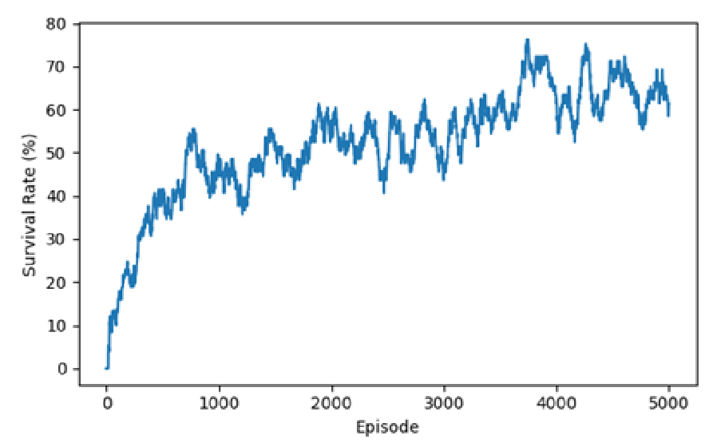
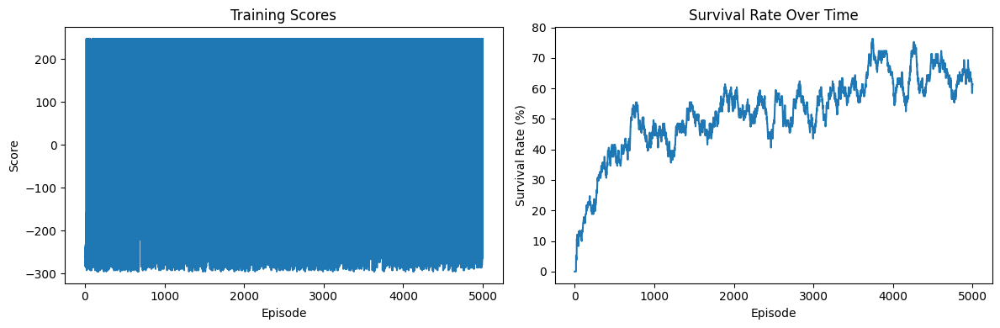

# RADAR — Prey vs Hunters Reinforcement Learning

A small reinforcement-learning sandbox where a **prey** (the "animal") learns to survive on a 10x10 grid against three **hunters** that chase it down. The prey is trained with a Deep Q-Network (DQN); hunters follow a simple greedy or random policy. Includes a Pygame GUI to watch the trained agent play live.

## Results

The trained prey agent's survival rate over ~5000 training episodes:



Training score and survival rate side by side:



## Project structure

```
Radar_RL.ipynb          Main notebook: environment, DQN, training and evaluation
RADAR/
  radar_rl.py            Standalone training script (same environment/agent as the notebook)
  radar_adapter.py        Loads a trained model and exposes policy_action() for external use
  forest_rl_gui_integrated.py   Pygame GUI that runs a trained agent live
  prey_dqn_model.pth      Trained DQN weights
  prey_dqn_meta.json       Model metadata (state/action sizes)
milestones/              Earlier checkpoints kept for comparison (weights + notebook snapshot)
assets/                  Result charts used in this README
```

## Setup

```bash
python -m venv .venv
.venv\Scripts\activate        # on Windows
pip install -r requirements.txt
```

## Usage

**Watch the trained agent play:**

```bash
cd RADAR
python forest_rl_gui_integrated.py
```

Controls:

| Key     | Action                        |
|---------|--------------------------------|
| SPACE   | Play / pause                  |
| N       | Step one turn (while paused)  |
| R       | Reset episode                 |
| + / -   | Adjust simulation speed       |
| M       | Toggle animal: model vs random |
| H       | Toggle hunters: greedy vs random |
| ESC / Q | Quit                           |

**Train a new agent:**

```bash
cd RADAR
python radar_rl.py
```

This runs a short training loop and saves `prey_dqn_model.pth` / `prey_dqn_meta.json`. For full training runs, see `Radar_RL.ipynb`.

## How it works

- The prey observes its own position, remembered "flares" it has dropped, and any hunters currently within its sight radius (distance, direction, awareness), plus distance to each wall — a 27-value state vector.
- Actions: `up`, `down`, `left`, `right`, `still`, `smell` (smell drops a scent flare that can make hunters aware of the prey's last known position).
- Hunters chase greedily once aware/detected, otherwise patrol randomly.
- Reward: large penalty for being caught, large bonus for surviving the full episode, small reward per turn survived.

---

# Gold trading model (`gold_trader/`)

A walk-forward model that predicts whether gold closes higher on the next bar and backtests a strategy based on that prediction, net of costs.

- **Features** (built from closing prices only): momentum over 1/5/10/20/60 bars, realised volatility and volatility regime, distance from the 20/50/200 moving averages, a 20/50 MA cross, RSI(14) and position within the 60-bar range.
- **Macro features** (downloaded from FRED by default, no API key needed):
  - **Real rates:** the 10-year TIPS yield (`DFII10`): its level, its change over 5/20/60 bars, and how far it sits from its 1-year average. Gold pays no yield, so higher real rates make holding it more costly.
  - **Dollar index:** the broad trade-weighted dollar (`DTWEXBGS`): its momentum over 5/20/60 bars, its distance from the 50-day average, and gold's 60-day correlation with it.
  - **Gold ETF flows:** daily tonnes of gold held by SPDR Gold Shares (GLD), the largest gold ETF, from its published history file. The model uses the % change in holdings over 5/20/60 bars (inflows or outflows), how unusual the last 20 days of flows are against the past year, how far holdings sit below their 1-year peak, and flows minus gold's own 20-day return (investors buying dips or selling rallies).
  - Macro and ETF data are shifted one bar later by default (`--macro-lag`), because FRED often publishes values a day or more after the date they cover. The broad dollar index starts in 2006, so tests that use it begin later.
- **Model:** L2-regularised logistic regression (numpy). It is refit every `retrain_every` bars using only data known at that point, so no future data leaks into a decision (this is checked in a test).
- **Trading rule:** go long when P(up) > 0.5 + `band`. Short positions are optional (`--allow-short`). Position size is scaled to a 15% annual volatility target, capped at 1x, with 2 bps charged per unit of turnover.
- **Output:** strategy metrics next to buy-and-hold for the same period, plus today's signal.

```bash
pip install pandas numpy yfinance matplotlib
python -m gold_trader                          # daily GC=F gold futures from Yahoo since 2005
python -m gold_trader --csv my_gold.csv        # any CSV with a date and a close/price column
python -m gold_trader --macro-csv macro.csv    # your own date, real_rate, dollar (and optionally etf_holdings) columns
python -m gold_trader --etf-csv gld.csv        # your own ETF holdings file instead of downloading GLD's
python -m gold_trader --macro none --etf none  # gold price features only
python -m gold_trader --allow-short --band 0.03 --plot equity.png --out results.csv
python -m unittest discover gold_trader/tests  # run the tests
```

Treat the results with skepticism. In a monthly test without macro or ETF features on gold prices from 1998 to 2026, the model returned 5.6% a year (Sharpe ratio 0.63, worst drawdown −27%). Simply holding gold returned 10.2% a year (Sharpe 0.80, worst drawdown −39%). The model's smaller drawdown comes from staying out of the market about 60% of the time. That is risk reduction, not proof that the model can predict gold prices. This is a research tool, not financial advice.
